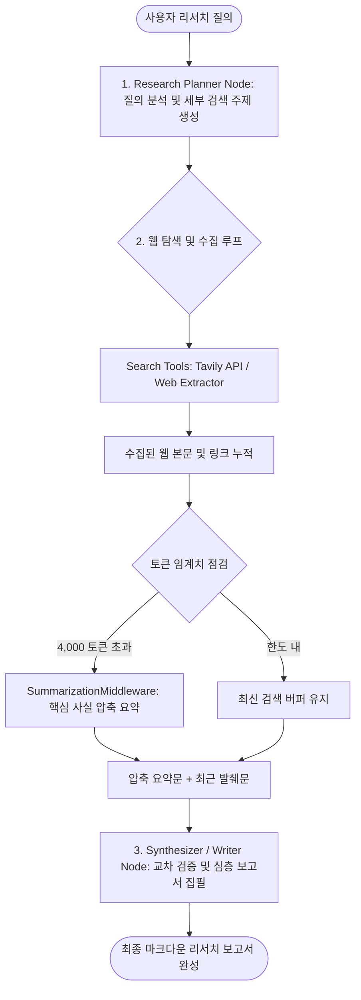
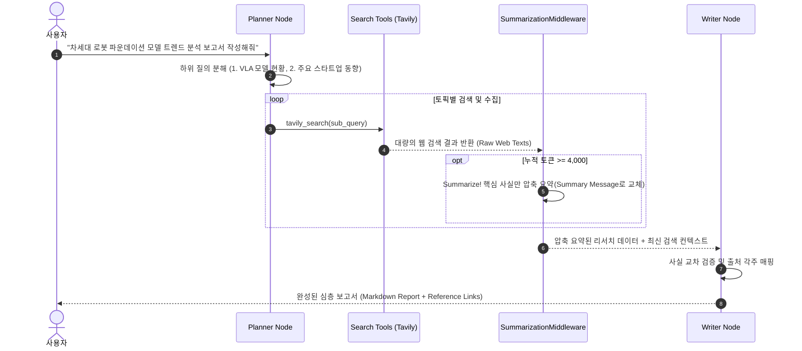

# 지능형 웹 리서치 에이전트 (The Intelligent Researcher)

> **문서 정의**: 사용자의 복합 탐색 요청을 체계적으로 분해하여 웹(Tavily 등)을 다각도로 탐색하고, 대량의 웹 데이터 유입 시 컨텍스트 초과를 방어하는 **SummarizationMiddleware(대화 압축 요약)**와 결합하여 고품질 분석 보고서를 작성하는 자율 리서치 에이전트 가이드입니다.  
> **관련 커리큘럼**: [Act Operator 5주차 프로젝트](file:///d:/git/act-operator/study/README.md#L109-L117) · LangGraph 1.0+ · `uv` workspace 기준

---

## 1. 단순 웹 검색 챗봇 vs 지능형 웹 리서치 에이전트 비교

| 비교 항목 | 단순 웹 검색 챗봇 (Single Query Search) | 지능형 웹 리서치 에이전트 (Intelligent Researcher) |
|---|---|---|
| **검색 방식** | 질문 그대로 1회 검색 후 단편 답변 생성 | 질의를 하위 토픽으로 분해(Planning) 후 **다각도 심층 탐색** |
| **토큰 한도 관리** | 검색 본문이 누적되면 토큰 초과로 에러 발생 | **`SummarizationMiddleware`**가 임계치 도달 시 자동 문맥 압축 |
| **정보 신뢰도** | 첫 번째 검색 결과에 의존하여 환각(Hallucination) 위험 | 복수 출처 교차 검증 및 본문 발췌 기반 **명시적 출처(URL) 각주 표기** |
| **산출물 형태** | 몇 줄의 단편적인 대화형 응답 | 서론, 시장 현황, 핵심 인사이트, 결론을 갖춘 **정규 마크다운 리포트** |
| **작업 제어 흐름** | 단일 프롬프트에 모든 작업 위임 | **기획(Planner) → 수집(Searcher) → 집필(Writer)** 파이프라인 분리 |

---

## 2. 아키텍처 및 연구 파이프라인 (Research Pipeline Topology)



---

## 3. 핵심 구성 요소

### 3.1 웹 검색 및 본문 추출 도구 (`tools.py`)
- **`tavily_search`**: 실시간 웹 검색을 통해 신뢰할 수 있는 상위 URL 목록과 스니펫을 획득합니다.
- **`fetch_web_content`**: 특정 URL의 원문 HTML을 파싱하고 불필요한 태그를 제거한 클린 마크다운 텍스트를 추출합니다.

### 3.2 대화 요약 미들웨어 (`SummarizationMiddleware`)
- 웹 검색 결과는 원문 텍스트가 방대하여 몇 번의 검색만으로도 모델의 컨텍스트 윈도우(Context Window)를 소진하기 쉽습니다.
- `trigger=("tokens", 4_000)`: 대화 및 검색 버퍼가 4,000 토큰에 도달하면 자동으로 LLM을 호출하여 기존 지식을 압축 요약합니다.
- `keep=("messages", 10)`: 가장 최근 턴의 최신 메시지는 온전히 유지하여 에이전트의 맥락 판단력을 보존합니다.

### 3.3 역할 분리형 노드 아키텍처 (`agents.py` / `nodes.py`)
- **`planner_node`**: 복잡한 주제(예: *"2026 AI 반도체 시장 동향과 주요 플레이어 비교"*)를 3~4개의 구체적인 검색 쿼리로 쪼갭니다.
- **`writer_node`**: 누적 요약문과 최신 검색 데이터를 바탕으로 객관적인 데이터와 출처 링크를 포함한 구조화된 리포트를 생성합니다.

---

## 4. 세부 실행 시나리오 및 라이프사이클



---

## 5. Act Operator 프로젝트 관점 구현 (`uv workspace`)

Act Operator의 모노레포 구조([study/Week-All.md:L550-L610](file:///d:/git/act-operator/study/Week-All.md#L550-L610))를 기반으로 `web_researcher` Cast를 구현한 표준 디렉토리입니다:

```text
my-act/
├── pyproject.toml                 # uv workspace (members = ["casts/*"])
├── langgraph.json                 # web_researcher 그래프 진입점 등록
├── casts/
│   └── web_researcher/           # 지능형 웹 리서치 전담 Cast
│       ├── modules/
│       │   ├── state.py           # ResearchState (쿼리, 검색 결과, 요약본, 최종 리포트)
│       │   ├── tools.py           # tavily_search, fetch_web_content 정의
│       │   ├── middlewares.py     # SummarizationMiddleware 설정
│       │   └── nodes.py           # planner_node, research_node, writer_node
│       ├── graph.py               # create_agent 또는 StateGraph 파이프라인 컴파일
│       └── pyproject.toml         # tavily-python, beautifulsoup4 등 독립 의존성
└── tests/
    └── cast_tests/
        └── test_researcher.py     # 검색 도구 Mocking 및 요약 미들웨어 단위 테스트
```

### 5.1 핵심 코드 구현 스니펫 (`graph.py` & `middlewares.py`)

```python
from __future__ import annotations

from langchain.agents import create_agent
from langchain.agents.middleware import SummarizationMiddleware
from langgraph.checkpoint.memory import InMemorySaver

from casts.web_researcher.modules.tools import fetch_web_content, tavily_search

# 1. 자동 토큰 압축 요약 미들웨어 구성
summarizer = SummarizationMiddleware(
    model="gpt-4o-mini",          # 요약 전용 경량 모델 적용으로 비용 및 지연시간 최적화
    trigger=("tokens", 4_000),    # 4,000 토큰 초과 시 압축 발동
    keep=("messages", 8),         # 최근 대화 8개는 원형 유지
)

# 2. 리서처 에이전트 생성
researcher_agent = create_agent(
    model="gpt-4o",
    tools=[tavily_search, fetch_web_content],
    middleware=[summarizer],
    checkpointer=InMemorySaver(),
)
```

### 5.2 실행 및 보고서 생성 예시

```python
config = {"configurable": {"thread_id": "research-session-42"}}

response = researcher_agent.invoke(
    {
        "messages": [
            {
                "role": "user",
                "content": "2026년 에이전틱 AI 프레임워크 동향을 조사하고 비교 분석 보고서를 작성해줘.",
            }
        ]
    },
    config=config,
    version="v2",
)

# 최종 작성된 마크다운 보고서 출력
print(response["messages"][-1].content)
```

---

## 6. 주요 도입 효과

1. **무제한 심층 탐색 지속성**: 대량의 웹 문서가 유입되어도 `SummarizationMiddleware`가 문맥을 자동으로 압축 관리하므로 컨텍스트 한도 오류(Context Overflow) 없이 연구를 지속합니다.
2. **비용 및 지연시간 최적화**: 본문 요약에는 고비용 모델 대신 경량 모델(`gpt-4o-mini` 등)을 전담 배치하여 API 호출 비용을 대폭 절감합니다.
3. **출처 투명성 확보**: 모든 주장과 데이터 뒤에 실제 탐색한 URL과 발행 연도가 각주로 첨부되어 신뢰성 높은 팩트 체크가 가능합니다.
4. **리포트 작성 시간 90% 단축**: 사람의 수작업 검색-정리-작성 사이클을 수 분 내 자동화하여 즉시 의사결정에 활용할 수 있는 리포트를 제공합니다.
