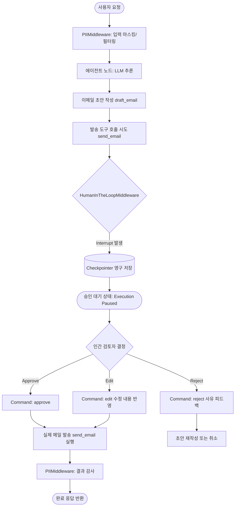
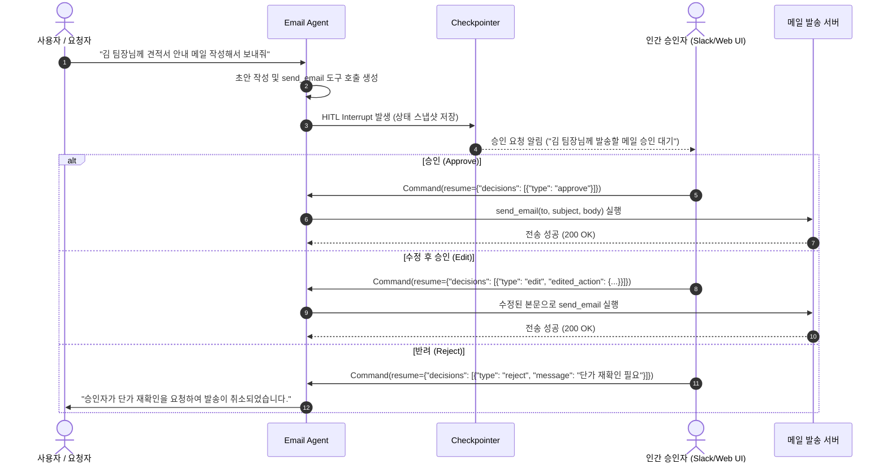

# 승인 기반 이메일 자동화 봇 (Human-in-the-loop Email Assistant)

> **문서 정의**: 외부 발송 및 실제 부작용(Side-effect)을 유발하는 작업 전에 사람의 개입을 보장하는 **Human-in-the-loop(HITL, 승인·수정·반려)** 패턴과, 민감 정보 유출을 원천 방지하는 **PII 마스킹 미들웨어**를 결합한 엔터프라이즈급 이메일 자동화 에이전트 가이드입니다.  
> **관련 커리큘럼**: [Act Operator 6주차 프로젝트](file:///d:/git/act-operator/study/README.md#L120-L128) · LangGraph 1.0+ · `uv` workspace 기준

---

## 1. 통제되지 않은 봇 vs 승인 기반 HITL 에이전트 비교

| 비교 항목 | 무단 자동 발송 봇 (Uncontrolled Bot) | 승인 기반 이메일 비서 (HITL Email Assistant) |
|---|---|---|
| **오발송 위험성** | LLM 환각으로 잘못된 수신자/내용 즉시 전송 (비가역적 사고) | 발송 도구 실행 직전 중단(Interrupt)되어 **사람의 검토 후 전송** |
| **개인정보 보호 (PII)** | 계좌번호, 연락처, 주민번호 등 민감 데이터가 평문 노출 | **`PIIMiddleware`**를 통해 입력/출력 단계에서 자동 마스킹·차단 |
| **유연한 개입 권한** | 전송 실패 시 예외 처리만 가능, 내용 수정 불가 | 승인(`approve`), 내용 수정(`edit`), 거절(`reject`) 3단계 피드백 지원 |
| **작업 영속성** | 승인 대기 중 프로세스가 종료되면 작업 맥락 유실 | **체크포인터(Checkpointer)**로 중단점 스냅샷을 영구 보존 후 재개 |
| **컴플라이언스** | 금융/법률/보안 규정 준수 불가 (자동화 위험군) | 사람의 최종 서명/승인 로그가 감사 추적(Audit Trail)으로 확보 |

---

## 2. 아키텍처 및 인터럽트 메커니즘 (HITL Topology)



---

## 3. 핵심 구성 요소

### 3.1 `HumanInTheLoopMiddleware` (도구 수준 제어)
- 부작용이 없는 조회/초안 작성(`draft_email`)은 자동 통과시키고, 실제 발송 도구(`send_email`)에만 인터럽트를 설정합니다.
- `allowed_decisions=["approve", "edit", "reject"]`를 부여하여 단순 승인뿐만 아니라 오탈자 수정이나 반려 후 피드백을 전달할 수 있습니다.

### 3.2 `PIIMiddleware` (민감 정보 감지 및 마스킹)
- 개인 식별 정보(전화번호, 주민등록번호, 계좌번호, API Key 등)를 정규식 또는 모델 기반 디텍터로 감지합니다.
- `mask`(마스킹), `redact`(삭제), `block`(즉시 차단), `hash`(해시화) 등의 보호 전략을 수립하여 프롬프트 주입 및 로그 유출을 방지합니다.

### 3.3 상태 영속성 (`Checkpointer`) 및 재개 커맨드 (`Command`)
- 인터럽트 발생 시 현재 그래프의 상태(`messages`, `tool_calls` 등)가 지정된 `thread_id` 단위로 체크포인터에 저장됩니다.
- 검토자가 승인 결정을 내리면 `Command(resume=...)`를 통해 일시 정지된 시점부터 그래프를 재개(Resume)합니다.

---

## 4. 3단계 승인/피드백 라이프사이클



---

## 5. Act Operator 프로젝트 관점 구현 (`uv workspace`)

Act Operator의 모노레포 구조([study/Week-All.md:L511-L548](file:///d:/git/act-operator/study/Week-All.md#L511-L548))를 바탕으로 `email_assistant` Cast를 독립 모듈로 구현한 구성입니다:

```text
my-act/
├── pyproject.toml                 # uv workspace (members = ["casts/*"])
├── langgraph.json                 # email_assistant 그래프 엔트리포인트 등록
├── casts/
│   └── email_assistant/          # 승인 기반 이메일 전문 Cast
│       ├── modules/
│       │   ├── state.py           # EmailAgentState (메시지, 초안 데이터, 승인 이력)
│       │   ├── tools.py           # draft_email, send_email, search_contacts
│       │   └── middlewares.py     # HumanInTheLoopMiddleware, PIIMiddleware 구성
│       ├── graph.py               # create_agent 기반 컴파일 및 Checkpointer 연결
│       └── pyproject.toml         # Cast 독립 의존성 정의
└── tests/
    └── cast_tests/
        └── test_email_hitl.py     # Interrupt 중단 및 resume 결정 모킹 단위 테스트
```

### 5.1 핵심 코드 구현 스니펫 (`graph.py` & `middlewares.py`)

```python
from __future__ import annotations

from langchain.agents import create_agent
from langchain.agents.middleware import HumanInTheLoopMiddleware, PIIMiddleware
from langgraph.checkpoint.memory import InMemorySaver  # 프로덕션에서는 PostgresSaver 사용
from langgraph.types import Command

from casts.email_assistant.modules.tools import draft_email, send_email

# 1. PII 보안 미들웨어 설정
pii_middleware = PIIMiddleware(
    "contact_info",
    strategy="mask",
    apply_to_input=True,
)

# 2. HITL 승인 미들웨어 설정
hitl_middleware = HumanInTheLoopMiddleware(
    interrupt_on={
        "send_email": {
            "allowed_decisions": ["approve", "edit", "reject"],
        },
        "draft_email": False,  # 조회/초안은 중단 없이 통과
    },
    description_prefix="[발송 승인 대기] 이메일 최종 검토 요청",
)

# 3. 에이전트 빌드 및 체크포인터 바인딩
email_agent = create_agent(
    model="gpt-4o",
    tools=[draft_email, send_email],
    middleware=[pii_middleware, hitl_middleware],
    checkpointer=InMemorySaver(),
)
```

### 5.2 재개(Resume) 호출 예시

```python
# 승인 대기 발생 후 thread_id를 기준으로 승인 처리
config = {"configurable": {"thread_id": "email-session-1024"}}

# 인간 승인자가 승인을 결정한 경우
email_agent.invoke(
    Command(resume={"decisions": [{"type": "approve"}]}),
    config=config,
    version="v2",
)
```

---

## 6. 주요 도입 효과

1. **치명적 사고 예방**: 금융/영업/인사 등 민감 메일의 환각 발송 및 수신자 오지정을 사전에 100% 차단합니다.
2. **비동기 승인 체계 통합**: 사내 슬랙(Slack), 잔디(Jandi), 웹 대시보드와 체크포인터의 `thread_id`를 결합하여 실시간 승인 버튼 인터페이스를 구축할 수 있습니다.
3. **개인정보 컴플라이언스 준수**: 메일 작성 과정에서 노출되는 고객 연락처와 결제 정보가 자동으로 마스킹되어 개인정보보호법 가이드라인을 충족합니다.
4. **점진적 자동화(Gradual Automation)**: 초기에는 100% 사람 승인을 거치고, 에이전트의 신뢰도가 검증되면 내부 규칙에 따라 일부 정형 메일만 자동 승인으로 전환할 수 있습니다.
