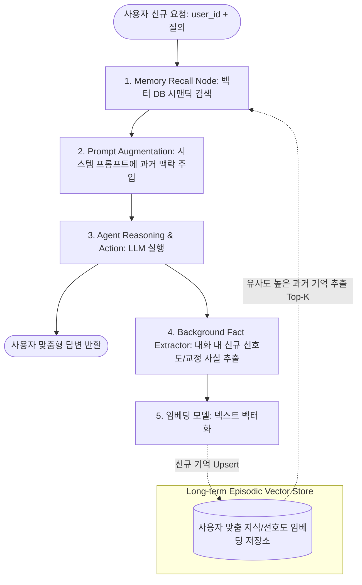
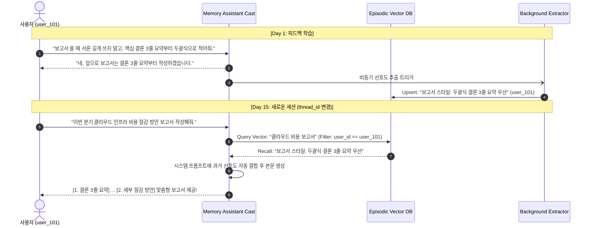

# 장기 기억 기반 사용자 맞춤형 업무 비서 (Long-term Episodic Memory)

> **문서 정의**: 일회성 세션(단기 대화)을 넘어 사용자의 과거 지시 사항, 교정 피드백, 업무 스타일, 프로젝트 맥락을 **임베딩 및 벡터 데이터베이스**에 구조화된 지식으로 축적하고, 새로운 요청 시 의미적 유사도(Semantic Similarity)로 관련 기억을 자동 회상(Recall)하여 1:1 맞춤형 결과물을 산출하는 에피소딕 메모리 에이전트 가이드입니다.  
> **관련 커리큘럼**: [Act Operator 심화 프로젝트](file:///d:/git/act-operator/study/README.md) · LangGraph 1.0+ · `langgraph.store` & Vector DB · `uv` workspace 기준

---

## 1. 단기 세션 챗봇 vs 장기 기억(Episodic Memory) 비서 비교

| 비교 항목 | 단기 세션 챗봇 (Stateless / Short-term) | 장기 기억 비서 (Long-term Episodic Assistant) |
|---|---|---|
| **기억 지속 기간** | 세션 종료, 브라우저 새로고침 시 맥락 완전 초기화 | 세션이 끊겨도 수개월·수년 간 **영구 저장소(Vector DB)**에 보존 |
| **개인화 수준** | 매번 대화할 때마다 "내 업무 스타일은 이래"라고 재설명 필요 | 과거 피드백을 기억하여 **말하지 않아도 사전 취향 반영** |
| **메모리 저장 방식** | 대화 전체를 슬라이딩 윈도우로 단순 누적 (토큰 낭비) | 대화 중 **핵심 사실/선호도만 추출(Extraction)**하여 임베딩 저장 |
| **맥락 주입 방식** | 이전 대화 전문을 프롬프트에 무작정 주입 | 사용자 질의와 가장 연관된 기억 조각만 **Top-K 시맨틱 검색 주입** |
| **테넌트 격리** | 단일 스레드 수준의 분리만 가능 | `user_id` / `org_id` 단위의 엄격한 **네임스페이스(Namespace) 격리** |

---

## 2. 메모리 생애주기 아키텍처 (Memory Lifecycle Topology)



---

## 3. 핵심 구성 요소 및 메모리 계층

### 3.1 3계층 메모리 아키텍처 (Three-Tier Memory)
1. **작업 메모리 (Working Memory)**: 현재 실행 턴의 단기 `State["messages"]`.
2. **단기 체크포인터 (Short-term Checkpointer)**: 동일 `thread_id` 내의 인터럽트(HITL), 오류 복구, 대화 턴 유지 (`PostgresSaver` / `InMemorySaver`).
3. **장기 에피소딕 메모리 (Long-term Episodic Memory)**: 스레드를 초월한 영구 저장소. `user_id` 네임스페이스로 분리된 Vector DB(Chroma, Pinecone, pgvector 등) 및 `langgraph.store`.

### 3.2 선호도 추출기 (Preference & Fact Extractor)
- 사용자의 일상 대화 중 명시적 피드백이나 교정 사항을 포착하여 구조화된 JSON 데이터로 변환합니다.
- 예: *"앞으로 보고서에는 코드 스니펫 대신 실행 결과 표를 먼저 넣어줘"* 
  → `{"category": "report_style", "preference": "결과 표 우선 배치, 코드 스니펫 후순위", "target": "reports"}`

### 3.3 시맨틱 회상 도구 (`tools.py`)
- 질의가 들어왔을 때 사용자의 질문 텍스트를 임베딩하여 벡터 DB에 질의합니다.
- 시간 감쇠(Recency Decay) 가중치와 유사도 점수를 결합하여, 가장 최신이면서도 맥락에 부합하는 선호도를 프롬프트에 주입합니다.

---

## 4. 작동 시나리오 및 시퀀스 흐름



---

## 5. Act Operator 프로젝트 관점 구현 (`uv workspace`)

Act Operator의 모노레포 구조를 기반으로 장기 기억 비서 Cast(`memory_assistant`)를 구성한 예시입니다:

```text
my-act/
├── pyproject.toml                 # uv workspace (members = ["casts/*"])
├── langgraph.json                 # memory_assistant 그래프 진입점 등록
├── casts/
│   └── memory_assistant/         # 장기 기억 기반 맞춤형 비서 Cast
│       ├── modules/
│       │   ├── state.py           # MemoryState (messages, user_id, recalled_memories)
│       │   ├── models.py          # LLM 및 임베딩 모델(OpenAIEmbeddings 등) 팩토리
│       │   ├── tools.py           # recall_memories, record_feedback 정의
│       │   └── nodes.py           # recall_node, chat_node, extract_memory_node
│       ├── graph.py               # 2단계 파이프라인(Recall → Chat → Memorize) 그래프 컴파일
│       └── pyproject.toml         # chromadb, langchain-openai 등 Cast 의존성
└── tests/
    └── cast_tests/
        └── test_episodic_memory.py # 기억 저장 및 시맨틱 회상 검증 테스트
```

### 5.1 핵심 코드 구현 스니펫 (`modules/nodes.py` & `graph.py`)

```python
from __future__ import annotations

from typing import TypedDict
from langchain_core.messages import BaseMessage, SystemMessage
from langgraph.graph import StateGraph, START, END

from casts.memory_assistant.modules.models import get_chat_model, get_embedding_model
from casts.memory_assistant.modules.tools import search_user_memories, extract_and_save_memory


class MemoryState(TypedDict):
    user_id: str
    messages: list[BaseMessage]
    recalled_memories: list[str]


def recall_node(state: MemoryState) -> dict:
    """사용자 질의와 관련된 과거 기억을 벡터 DB에서 검색하여 주입합니다."""
    last_user_message = state["messages"][-1].content
    memories = search_user_memories(
        user_id=state["user_id"],
        query=str(last_user_message),
        k=3,
    )
    return {"recalled_memories": memories}


def chat_node(state: MemoryState) -> dict:
    """회상된 기억을 시스템 프롬프트에 동적 결합하여 개인화된 응답을 생성합니다."""
    llm = get_chat_model()
    
    memory_context = "\n".join([f"- {m}" for m in state["recalled_memories"]])
    system_prompt = (
        "당신은 사용자의 전담 AI 비서입니다. 아래 사용자의 과거 선호도와 업무 스타일을 반영하여 답변하세요:\n"
        f"[과거 기억 및 선호도]\n{memory_context or '기록된 선호도 없음'}"
    )
    
    messages = [SystemMessage(content=system_prompt)] + state["messages"]
    response = llm.invoke(messages)
    return {"messages": [response]}


def memorize_node(state: MemoryState) -> dict:
    """대화 내용에서 새로운 사실이나 피드백을 추출하여 벡터 DB에 영구 저장합니다."""
    extract_and_save_memory(
        user_id=state["user_id"],
        messages=state["messages"],
    )
    return {}


# 그래프 파이프라인 빌드
builder = StateGraph(MemoryState)
builder.add_node("recall", recall_node)
builder.add_node("chat", chat_node)
builder.add_node("memorize", memorize_node)

builder.add_edge(START, "recall")
builder.add_edge("recall", "chat")
builder.add_edge("chat", "memorize")
builder.add_edge("memorize", END)

memory_assistant_graph = builder.compile()
```

---

## 6. 주요 도입 효과

1. **반복 지시 피로도 제로**: 한 번 교정한 내용(문체, 양식, 금기 사항)을 에이전트가 영구 기억하므로, 매 세션마다 프롬프트를 복사·붙여넣기할 필요가 없습니다.
2. **토큰 비용 최적화**: 과거 수십만 자의 대화 전문을 프롬프트에 유지하는 대신, 현재 질의와 연관된 상위 3~5개의 핵심 기억 조각만 주입하여 API 비용을 80% 이상 절감합니다.
3. **엄격한 다중 사용자 보안 (Multi-tenancy)**: 벡터 DB의 네임스페이스와 메타데이터 필터링(`user_id`, `department_id`)을 통해 다른 사용자의 기억이 섞이거나 유출되는 위험을 원천 차단합니다.
4. **상호작용 기반 지속적 진화**: 대화가 누적될수록 사용자 맞춤형 지식 그래프/벡터가 풍부해져 시간이 지날수록 전용 비서로서의 완성도가 극대화됩니다.
